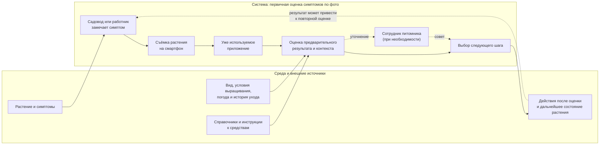

# Лабораторная работа 1. Границы и цель системы

**Тема:** диагностика болезней растений по фото

**Статус:** предварительный вариант. Добавлены три личных наблюдения на территории промышленного сада «Сады Придонья»; доступный собеседник — сотрудник питомника. Точные участки, виды растений и названия приложений требуют уточнения.

## 1. Система

Объект анализа — повторяющийся процесс первичной оценки симптомов растений по фотографии на территории промышленного сада «Сады Придонья»: человек замечает пятно или изменение окраски, фотографирует растение на смартфон, приложение выдаёт предварительную классификацию, а её приходится оценивать с учётом вида растения и условий его произрастания. Этот процесс можно наблюдать на месте; доступный собеседник — сотрудник питомника, у которого можно спросить, как проверяют вывод приложения и что делают при неопределённости. Анализируется существующая практика, а не будущий AI-продукт темы.

## 2. Граница системы

Граница проведена вокруг одной первичной оценки состояния растения — от замеченного симптома до решения о следующем шаге. Внутри находятся человек, который фотографирует растение, смартфон с уже используемым приложением, оценка полученного предположения с учётом условий роста и обращение к сотруднику питомника при необходимости. Само растение рассматривается как объект диагностики.

За границей остаются условия, влияющие на вывод: вид и состояние растения, погода и условия выращивания, история ухода, а также справочники и инструкции к средствам. Фактическое применение рекомендации и последующее состояние растения не входят в одну первичную оценку; результат может стать входом для повторного обращения. Продажа товара сама по себе не входит в систему, но интерес питомника к продаже спорен: если рекомендация зависит от наличия товара или плана продаж, этот элемент придётся включить и изучить.

### Спорные решения о границе

- **Продажа препарата.** Пока исключена: изучается консультация, а не торговый процесс. Если консультант рекомендует только имеющиеся в продаже средства или на решение влияет план продаж, продажу и интерес владельца питомника следует включить.
- **Применение рекомендации.** Исключено из одной консультации, поскольку решение может быть принято позже и зависит от садовода. Но без проверки результата нельзя понять, помогла ли рекомендация; обратная связь показана как внешняя связь.
- **Приложение.** Уже используемое приложение рассматривается как инструмент текущего процесса, а не как проектируемый продукт. Разработка или обучение новой AI-модели в границы не входят.

## 3. Заинтересованные стороны

| Сторона | Чего хочет от системы | Возможное расхождение интересов |
|---|---|---|
| Садовод | Понять вероятную причину, быстро получить понятный и безопасный следующий шаг, не потерять растение и не тратить деньги зря | Может предпочитать немедленное лечение при недостатке данных |
| Продавец-консультант / агроном | Дать обоснованный совет, не пропустить опасный случай и не рекомендовать неподходящую обработку | На качественную диагностику нужно время; у продавца может быть дополнительный интерес к продаже товара |
| Владелец питомника | Сохранять доверие и возвращаемость клиентов, организовать консультации без чрезмерной нагрузки | Скорость обслуживания или продажи могут конфликтовать с осторожной проверкой диагноза |
| Растение и урожай (затрагиваемая сторона) | Не пострадать от болезни, неверного ухода или неподходящей обработки | Не имеет собственного голоса в процессе; его состояние могут оценивать по неполным данным |
| Производитель средства / источник инструкции | Чтобы средство применяли согласно инструкции и ограничениям | Рекомендация «по похожему фото» может не учитывать культуру, дозу или срок ожидания |

Это предварительный список. На месте нужно проверить, кто реально участвует в консультации и есть ли у продавца конфликт между независимостью совета и продажей.

## 4. Записка: цель и проверка результата

**Цель системы** — помочь садоводу принять обоснованное и безопасное решение о следующем шаге при появлении симптомов у растения, не выдавая предположение по фотографии за подтверждённый диагноз.

О достижении цели можно судить по данным консультаций:

1. **Завершённость решения:** доля обращений, где зафиксированы вероятная причина или неопределённость и понятный следующий шаг; единица — процент обращений. Источник — журнал консультаций или выборочный ручной учёт.
2. **Время до следующего шага:** время от первого обращения до рекомендации или направления к специалисту; единица — часы или дни. Источник — отметки времени обращений.
3. **Безопасность рекомендаций:** число рекомендаций по обработке без сверки с инструкцией и ограничениями для растения; единица — случаи за период. Источник — проверка записей и рекомендованных средств по инструкциям.

Эти показатели предложены для проверки, а не измерены: доступ к журналу, возможность сверки и базовые значения пока неизвестны. Для оценки качества диагноза также потребуется последующее наблюдение за растением или обратная связь садовода.

## 5. Наблюдения: что известно и что предстоит проверить

### Наблюдение 1. Влияние освещения на постановку диагноза

Около 13:00 на территории промышленного сада «Сады Придонья» при ярком прямом солнце на обычный смартфон фотографировали листья клёна с подозрением на мучнистую росу. Приложение распознало лист как здоровый: белый налёт на снимке слился с солнечными бликами. В тени сделали снимок заново. Удивило, насколько сильно освещение повлияло на результат: блики исказили видимые цвет и текстуру налёта, и для повторной диагностики пришлось изменить условия съёмки.

**Контекст требует уточнения:** точный участок сада, погодные условия и название приложения не зафиксированы. Причину ошибки — блики и их влияние на изображение — следует считать объяснением наблюдателя, а не подтверждённым техническим анализом приложения.

### Наблюдение 2. Масштаб и фокус снимка

Вечером на территории промышленного сада «Сады Придонья» заметили пятно на листе яблони, похожее на паршу, и сфотографировали его обычной камерой смартфона с расстояния около 1–1,5 м. На экране пятно казалось крупным, но на снимке занимало всего несколько пикселей; его края и мелкие детали разглядеть не удалось. Приложение определило только общий класс болезни. Удивило расхождение между тем, как пятно выглядело на экране, и тем, сколько деталей сохранилось на фотографии; для более детального рассмотрения понадобилась макросъёмка.

**Контекст требует уточнения:** точный участок сада, время, название приложения и результат отдельного снимка с макросъёмкой не зафиксированы. Предположение о том, что детали пятна позволили бы определить возбудителя, не подтверждено лабораторной диагностикой.

### Наблюдение 3. Влияние фона и контекста

Около 7:00 на территории промышленного сада «Сады Придонья» сфотографировали ветку папоротника или дикого кустарника с пожелтевшими краями листьев; на фоне были густая трава и земля. Приложение определило признаки как грибковую инфекцию. Наблюдатель связал пожелтение с нехваткой влаги на сухой каменистой почве. Удивило, что изображение без сведений об условиях роста привело к иному объяснению симптома. Из этого наблюдения возник вывод, что для оценки могут быть важны снимок растения целиком и контекст места, а не только отдельный лист.

**Контекст требует уточнения:** точный участок сада, вид растения и название приложения не зафиксированы. Способ подтверждения причины (нехватки влаги) и влияние фона на результат приложения не проверялись отдельно; это интерпретация наблюдателя, а не подтверждённый диагноз.

Следующие идеи остаются **гипотезами для проверки**, а не результатами наблюдений:

- Одной фотографии может быть недостаточно: консультант может попросить снимок другой части растения или уточнить симптомы.
- Похожие внешние признаки могут иметь разные причины, поэтому специалисту важны вид растения и история ухода, а не только изображение.
- При неопределённости безопасным следующим шагом может быть наблюдение или обращение к специалисту, а не немедленная обработка.

### Шаблон для фактических наблюдений

Перед сдачей уточните контекст наблюдений, если это возможно: место и время, точный вид растения, название приложения и способ проверки предполагаемой причины. Для каждого эпизода укажите, что именно произошло и чем это удивило или изменило первоначальное представление. Не записывайте предположение как факт.

| № | Место и время | Что увидел(а) или услышал(а) | Чем это удивило |
|---|---|---|---|
| 1 | Промышленный сад «Сады Придонья», около 13:00; яркое прямое солнце | На фото листа клёна с подозрением на мучнистую росу приложение выдало «здоровый лист»; после перехода в тень снимок сделали заново | Белый налёт слился с бликами, и освещение повлияло на результат распознавания |
| 2 | Промышленный сад «Сады Придонья», вечер | Пятно на листе яблони (похоже на паршу) сфотографировали со смартфона с расстояния около 1–1,5 м; на снимке пятно занимало несколько пикселей, приложение выдало общий класс болезни | На экране пятно казалось крупным, но снимок не передал детали; понадобилась макросъёмка |
| 3 | Промышленный сад «Сады Придонья», около 7:00 | На фоне густой травы и земли сфотографировали ветку папоротника или дикого кустарника с пожелтевшими краями; приложение определило грибковую инфекцию, а наблюдатель связал симптом с сухой каменистой почвой | Снимок не передавал весь контекст роста; возник вывод о необходимости фотографировать растение целиком и место произрастания |

## Источники и допущения

- [Описание темы «Диагностика болезней растений по фото»](https://sii.sergeivolchkov.ru/projects/ai-plant-doctor) — исходная постановка и роли, указанные в каталоге.
- [Требования лабораторной 1](https://github.com/ChS23/system-analysis-course/tree/main/lab1_boundaries) — система «как сейчас», граница, заинтересованные стороны, проверяемая цель и три наблюдения.

Место наблюдений и доступная роль для разговора определены: промышленный сад «Сады Придонья» и сотрудник питомника. Фактический порядок проверки диагноза, доступные записи и заинтересованные стороны ещё нужно подтвердить разговором с сотрудником; также полезно уточнить точные участки и виды растений, названия приложений, результат макросъёмки и способ проверки причины пожелтения. Поэтому документ остаётся предварительным вариантом.
