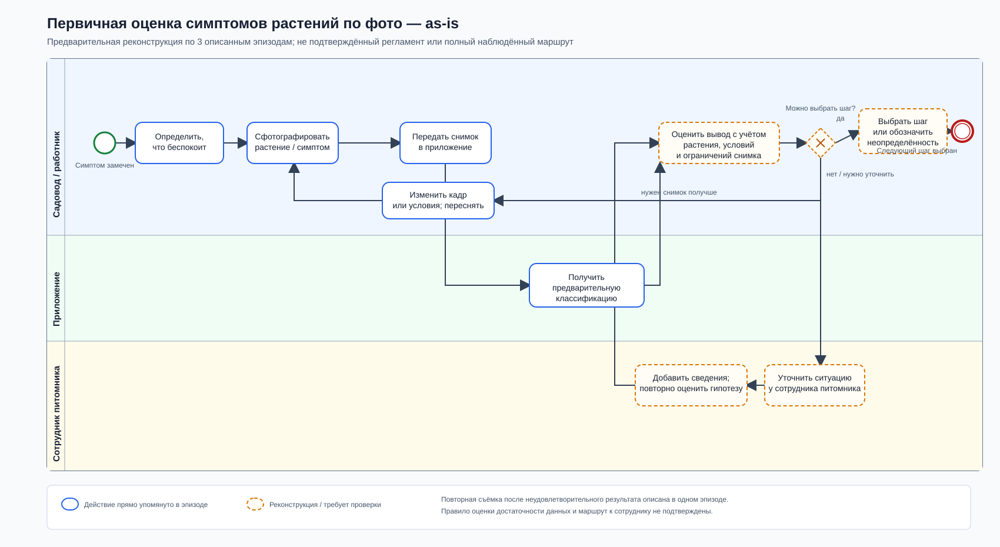

# Лабораторная работа 3. Процесс как он есть

**Тема:** первичная оценка симптомов растений по фотографии
**Объект анализа:** существующий процесс в промышленном саду «Сады Придонья», а не проектируемый AI-продукт.
**Статус:** предварительная реконструкция по материалам лабораторных 1 и 2. Она не заменяет наблюдение полного процесса и интервью с сотрудником питомника.

## 1. Как выбран процесс

Рассматривается повторяющийся процесс от замеченного симптома до выбора следующего шага. Он непосредственно связан с целью системы из лабораторной 1 и включает уже используемое приложение, а не новую модель. Граница заканчивается выбором следующего шага: фактическая обработка растения и проверка её результата в неё не входят.

## 2. Основание модели и степень подтверждения

В лабораторной 1 описаны три эпизода:

1. На снимке листа клёна при прямом солнце приложение не распознало предполагаемый белый налёт; в тени снимок сделали заново. Влияние бликов — объяснение наблюдателя, а не отдельная техническая проверка.
2. Пятно на листе яблони снимали с расстояния около 1–1,5 м; на снимке не хватило деталей, и приложение выдало общий класс болезни. Макросъёмка предложена как возможный способ улучшить снимок; результат повторной съёмки не зафиксирован.
3. Приложение классифицировало пожелтение листьев как грибковую инфекцию, а наблюдатель связал его с сухой каменистой почвой. Причина пожелтения и влияние фона отдельно не проверялись.

Эти эпизоды подтверждают отдельные действия и затруднения, но не устанавливают единый порядок работы, роль каждого участника или частоту ошибок. Лабораторная 2 описывает проверку гипотезы, уточнение неопределённости и обращение к сотруднику питомника как предполагаемые функции процесса; это ещё не подтверждённый порядок действий. В модели поэтому различаются:

- **опора на эпизоды** — замеченный симптом, съёмка, получение классификации; повторная съёмка при проблемном изображении зафиксирована в одном эпизоде;
- **реконструкция для проверки** — предварительная проверка качества снимка, оценка контекста, обращение за уточнением и выбор следующего шага. Этот порядок требуется пройти с участником процесса.

### Официальный порядок и сравнение

В переданных материалах лабораторных 1 и 2 регламент, инструкция или приказ по диагностике не приведены. Это означает только, что официальный порядок **не найден в изученных материалах**; утверждать, что его нет в организации, нельзя. Поэтому надёжно сравнить фактическую практику с официальным порядком пока невозможно.

| Эпизод или вопрос | Что зафиксировано в доступном описании | Что можно сказать о расхождении | Возможное объяснение (гипотеза) |
|---|---|---|---|
| Блики на снимке | Снимок повторили в тени после неудовлетворительного результата приложения | Наличие предписания переснимать при бликах не подтверждено; сравнение с регламентом невозможно | В материалах не описан или не использован единый протокол съёмки |
| Недостаток деталей | Дальний снимок дал приложению мало деталей и общий класс болезни | Неизвестно, требовал ли регламент макросъёмку и была ли она выполнена | Пользователь мог не знать подходящую дистанцию или возможности камеры |
| Контекст растения | В описании эпизода не зафиксированы проверка вида и условий роста приложением или сотрудником | Неизвестно, обязателен ли сбор этих сведений по официальным правилам | Один снимок удобнее, но может не содержать информации о виде и условиях |
| Кто принимает решение и когда нужен сотрудник | Лабораторная 2 называет обращение к сотруднику возможным способом уточнения | Фактический маршрут эскалации и полномочия не подтверждены | Маршрут может зависеть от уверенности пользователя и доступности сотрудника |

Причины в последнем столбце — рабочие гипотезы, а не установленные мотивы участников. По имеющимся данным нельзя определить, на каком шаге процесс «чаще всего» застревает: для этого нет журнала или выборки прогонов. Качество исходного снимка и недостаток контекста выглядят приоритетными точками проверки, но не измеренно самыми частыми проблемами.

## 3. Предварительная модель as-is

Ветвь повторной съёмки опирается на эпизод с бликами. Ветви уточнения контекста и консультации с сотрудником оставлены в модели как проверяемая реконструкция по лабораторной 2, а не как установленное правило. «Достаточно данных» — вопрос для участника процесса, а не заданный в организации критерий.

Исходник модели: [process-as-is.bpmn](./process-as-is.bpmn).

## 4. Что нужно проверить на месте

Чтобы превратить реконструкцию в подтверждённую модель, нужно пройти полный случай вместе с садоводом, работником или сотрудником питомника и зафиксировать:

1. Кто замечает симптом и кто инициирует оценку.
2. Какие и сколько снимков делают, кто решает переснять и по каким признакам.
3. Какие сведения о растении и условиях роста собирают до и после ответа приложения.
4. Кто оценивает классификацию, кто вправе принять решение и в каких случаях привлекают сотрудника питомника.
5. Какие следующие шаги реально предлагают и где проверяют ограничения инструкции, если речь идёт об обработке.
6. Есть ли официальный порядок, журнал обращений или записи о повторных консультациях; на каком шаге были задержки и почему.

Несколько прогонов нужны, чтобы отличить единичный эпизод от повторяющегося маршрута. До такого наблюдения не следует считать модель инструкцией для диагностики или безопасного применения препаратов.

## Источники и допущения

- [Материалы лабораторной 1](https://github.com/vib-system-analysis/sa-2026-pe1-egor-2026-20/blob/lab1-boundaries/lab1_boundaries/README.md): границы процесса и три описанных наблюдения.
- [Материалы лабораторной 2](../lab2_goals/README.md): функциональная декомпозиция, неопределённость и предполагаемая роль сотрудника питомника.
- [Требования лабораторной 3](https://github.com/ChS23/system-analysis-course/tree/main/lab3_process): модель as-is и записка о различиях с официальным процессом.
